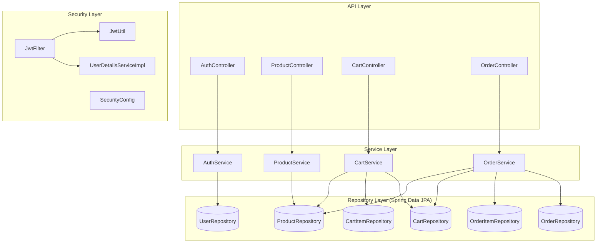
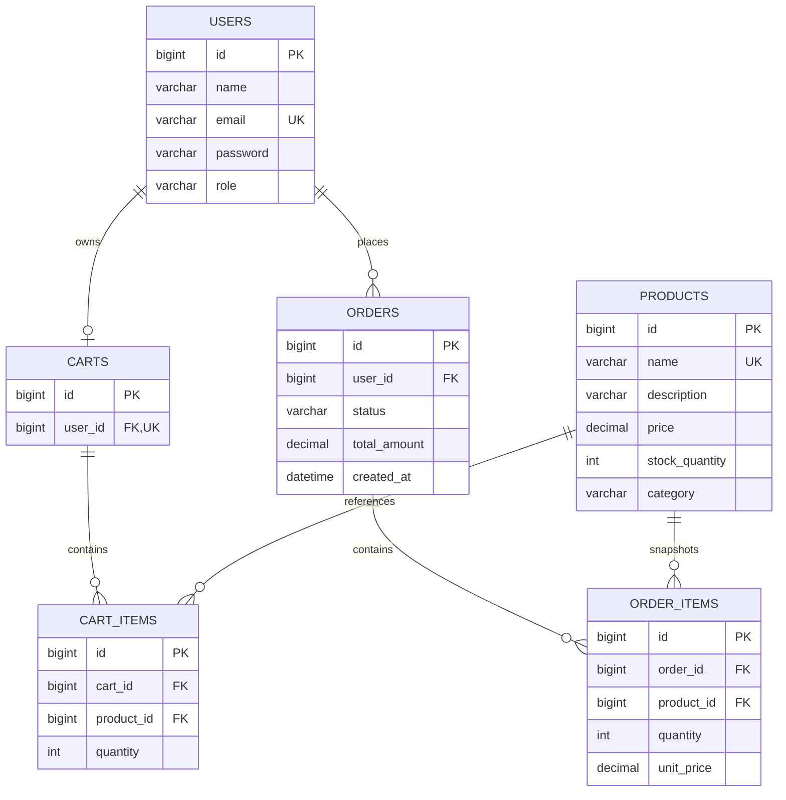

# Ubuy — E-Commerce REST API Backend

A production-grade, highly maintainable e-commerce RESTful backend built with **Java 17**, **Spring Boot 3**, **Spring Security 6**, **Spring Data JPA (Hibernate)**, and **MySQL**. Designed strictly following the **Controller → Service → Repository → Entity** layered architecture, constructor-based dependency injection, and clean separation between persistence models and client-facing DTOs.

---

## Tech Stack

| Technology | Purpose |
|---|---|
| **Java 17** | Core programming language (modern LTS) |
| **Spring Boot 3.2.x** | Enterprise application framework and autoconfiguration |
| **Spring Web (MVC)** | REST API controllers and HTTP request/response dispatching |
| **Spring Security 6** | Role-Based Access Control (RBAC) and stateless request filtering |
| **JSON Web Tokens (`jjwt 0.12.6`)** | Stateless, tamper-proof Bearer token authentication |
| **Spring Data JPA / Hibernate 6** | Data persistence, ORM mappings, and repository query abstractions |
| **MySQL 8.x** | Relational database storage |
| **Jakarta Bean Validation** | Declarative request payload validation (`@Valid`, `@NotBlank`, etc.) |
| **JUnit 5 & Mockito** | Comprehensive unit test suite |

> **Minimalist Dependency Policy**: Strictly avoids bloated libraries (no MapStruct, no Lombok, no external cache servers). Built using pure Spring Boot idioms.

---

## Architecture & Layering

The codebase strictly adheres to a unidirectional four-tier layering model:

```
[ HTTP Client / Postman ]
          │
          ▼
    Controllers         --> Validate request DTOs & map HTTP status codes
          │
          ▼
     Services           --> Business logic, @Transactional workflows & DTO conversion
          │
          ▼
   Repositories         --> Spring Data JPA interfaces with @EntityGraph optimizations
          │
          ▼
     Entities           --> Relational JPA database models
          │
          ▼
 [ MySQL Database ]
```



---

## Database Schema & Entity Relationships

The data model captures the complete customer lifecycle from authentication to cart checkout:



---

## Key Engineering Highlights

### 1. Stateless Role-Based Access Control (RBAC) with JWT
- All requests pass through `JwtFilter`, verifying Bearer tokens and loading Spring Security authorities without server-side HTTP sessions.
- Granular authorization policies enforced via `SecurityConfig` and method security (`@PreAuthorize`):
  - **Public**: `POST /api/auth/**` and `GET /api/products/**`
  - **CUSTOMER**: Cart operations (`/api/cart/**`), placing orders, and viewing personal order history (`/api/orders/my`).
  - **ADMIN**: Product mutation (`POST/PUT/DELETE /api/products/**`), viewing all platform orders, and updating delivery statuses.

### 2. Atomic Order Checkout & Historical Price Snapshotting
- Order placement executes inside a single `@Transactional` boundary in `OrderService.placeOrder()`:
  1. Validates that current cart is non-empty.
  2. Verifies real-time product stock for every item before altering state.
  3. **Price Snapshotting**: Copies `product.getPrice()` into `OrderItem.unitPrice` at moment of purchase. If a product's price changes later, historical order values remain immutable.
  4. Decrements `product.stockQuantity` and saves product records.
  5. Clears the user's shopping cart (`orphanRemoval = true`).

### 3. Hibernate N+1 Query Elimination via `@EntityGraph`
Loading carts and orders with associated items and products frequently introduces the classic N+1 query problem. Instead of multiple sequential queries, `CartRepository` and `OrderRepository` leverage JPA entity graphs:

```java
public interface OrderRepository extends JpaRepository<Order, Long> {
    @EntityGraph(attributePaths = {"items", "items.product"})
    List<Order> findByUserId(Long userId);

    @Override
    @EntityGraph(attributePaths = {"items", "items.product"})
    Optional<Order> findById(Long id);
}
```

**Result**: Hibernate executes a single SQL statement with `LEFT OUTER JOIN` clauses across `orders`, `order_items`, and `products`.

### 4. Idempotent Data Seeding
`DataInitializer` implements `CommandLineRunner` to seed an administrative account (`admin@ubuy.com` / `admin123`) and initial catalog items. It checks existence prior to insertion, guaranteeing that repeated server restarts never fail on duplicate keys.

---

## REST API Reference

### Authentication (`/api/auth`)
| Method | Endpoint | Role | Description |
|---|---|---|---|
| `POST` | `/api/auth/register` | Public | Register new customer account |
| `POST` | `/api/auth/login` | Public | Authenticate user & return JWT token |

### Products (`/api/products`)
| Method | Endpoint | Role | Description |
|---|---|---|---|
| `GET` | `/api/products` | Public | List all available catalog products |
| `GET` | `/api/products/{id}` | Public | Get single product details |
| `POST` | `/api/products` | `ADMIN` | Create a new product |
| `PUT` | `/api/products/{id}` | `ADMIN` | Update an existing product |
| `DELETE` | `/api/products/{id}` | `ADMIN` | Remove a product from catalog |

### Cart (`/api/cart`)
| Method | Endpoint | Role | Description |
|---|---|---|---|
| `GET` | `/api/cart` | `CUSTOMER` | Retrieve current authenticated user's cart |
| `POST` | `/api/cart/items` | `CUSTOMER` | Add product or increment item quantity |
| `DELETE` | `/api/cart/items/{itemId}` | `CUSTOMER` | Remove single item from cart |
| `DELETE` | `/api/cart` | `CUSTOMER` | Clear entire shopping cart |

### Orders (`/api/orders`)
| Method | Endpoint | Role | Description |
|---|---|---|---|
| `POST` | `/api/orders` | `CUSTOMER` | Checkout current cart and place order |
| `GET` | `/api/orders/my` | `CUSTOMER` | Retrieve order history for current user |
| `GET` | `/api/orders/{id}` | `CUSTOMER` / `ADMIN` | Retrieve single order details |
| `GET` | `/api/orders` | `ADMIN` | List all orders across all customers |
| `PUT` | `/api/orders/{id}/status` | `ADMIN` | Update order lifecycle status |

---

## Local Setup & Getting Started

### Prerequisites
- **Java 17+** (JDK 17 or higher)
- **MySQL 8.x** running locally or via Docker
- Git & curl / Postman

### 1. Clone & Configure Environment Variables
Copy or set the necessary database and security environment variables:

```bash
# Windows PowerShell
$env:DB_URL="jdbc:mysql://localhost:3306/ubuy?createDatabaseIfNotExist=true"
$env:DB_USERNAME="root"
$env:DB_PASSWORD="your_mysql_password"
$env:PORT="8082"
$env:JWT_SECRET="your-secure-random-256-bit-key-here"

# Linux / macOS
export DB_URL="jdbc:mysql://localhost:3306/ubuy?createDatabaseIfNotExist=true"
export DB_USERNAME="root"
export DB_PASSWORD="your_mysql_password"
export PORT="8082"
export JWT_SECRET="your-secure-random-256-bit-key-here"
```

### 2. Run Tests
Execute the unit test suite:
```bash
./mvnw test        # Linux / macOS
.\mvnw.cmd test    # Windows
```

### 3. Launch Application
Start the Spring Boot server:
```bash
./mvnw spring-boot:run        # Linux / macOS
.\mvnw.cmd spring-boot:run    # Windows
```
The server will start on port `8082` (or the port specified by `$PORT`). Hibernate will automatically create or update the schema tables on boot.

---

## Testing with Postman

An end-to-end collection is included in the project root: `ubuy-postman-collection.json`.

1. Open Postman and click **Import**.
2. Select [ubuy-postman-collection.json](file:///c:/Users/asus/Desktop/Ubuy/ubuy-postman-collection.json).
3. The collection is configured with automated test scripts:
   - **Login Customer**: Automatically captures the returned JWT token into the `{{token}}` collection variable.
   - **Login Admin**: Automatically captures the admin JWT token into the `{{adminToken}}` variable.
4. Execute requests in sequence:
   1. `Auth/Login Admin` (`admin@ubuy.com` / `admin123`)
   2. `Products/Create Product (Admin)`
   3. `Auth/Register Customer` & `Auth/Login Customer`
   4. `Cart/Add Item to Cart`
   5. `Orders/Place Order (Checkout)`
   6. `Orders/Get My Orders`
   7. `Orders/Update Order Status (Admin)`
