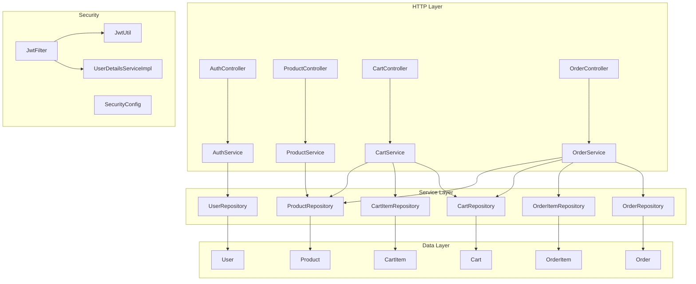

# Ubuy Backend Scaffold Implementation Plan

> **For agentic workers:** REQUIRED SUB-SKILL: Use superpowers:subagent-driven-development (recommended) or superpowers:executing-plans to implement this plan task-by-task. Steps use checkbox (`- [ ]`) syntax for tracking.

**Goal:** Scaffold a production-shaped Spring Boot 3.x REST backend for Ubuy covering Auth, Products, Cart, and Orders with JWT security and strict layering.

**Architecture:** Strict Controller → Service → Repository → Entity layering; each layer communicates via constructor-injected dependencies and plain Java DTOs — no entity objects ever leave the Service layer. JWT is stateless; `JwtFilter` validates every request before it hits a controller. The Security config is the only place that knows about roles and public routes.

**Architecture Diagram:**



**Tech Stack:** Java 17, Spring Boot 3.x, Spring Web, Spring Data JPA, Spring Security 6, Bean Validation, MySQL Driver, jjwt 0.12.6, JUnit 5, Mockito

**Spec:** `docs/superpowers/specs/` (no separate spec file; requirements are captured in this plan and in `AGENTS.md`)

## Global Constraints

- Java 17+ — use `var`, records are allowed for DTOs if desired, but plain classes are fine
- Spring Boot 3.x — Jakarta EE namespace (`jakarta.*`, not `javax.*`)
- Root package: `com.ubuy` — all source files live under it
- Constructor injection only — no `@Autowired` on fields
- No Lombok, no MapStruct, no extra libraries beyond the starters + jjwt 0.12.6
- MySQL: `jdbc:mysql://localhost:3306/ubuy_db`, user `root`, password `root`
- `spring.jpa.hibernate.ddl-auto=update` for dev; `data.sql` seeds one ADMIN user and three products
- Passwords stored BCrypt-hashed — never plaintext, never logged
- All `@RestController` methods return `ResponseEntity<T>`

## Review Focus

1. **Unauthenticated access to protected routes** — a request with no or invalid JWT must receive `401 Unauthorized`, not a Spring Security redirect or `403`
2. **Cart isolation** — a user must never be able to read or modify another user's cart; service must resolve the cart from the authenticated principal, not from a URL parameter
3. **Stock underflow on order** — placing an order for more quantity than `product.stockQuantity` must be rejected with `400 Bad Request` before any order row is written
4. **OrderItem unit price snapshot** — `OrderItem.unitPrice` must be copied from `Product.price` at order-creation time, not looked up at read time; a later product price change must not alter historical orders
5. **Admin-only product writes** — `POST/PUT/DELETE /api/products/**` must return `403 Forbidden` for a valid CUSTOMER token; the Security config, not the service, enforces this

---

## Task 1: Maven Project + Application Bootstrap

**Files:**
- Create: `pom.xml`
- Create: `src/main/java/com/ubuy/UbuyApplication.java`
- Create: `src/main/resources/application.properties`

**Interfaces:**
- Produces: a compilable, runnable Spring Boot app skeleton that all later tasks build on

- [ ] **Step 1: Create `pom.xml`**

  Group `com.ubuy`, artifact `ubuy`, Java 17, Spring Boot 3.2.x parent. Dependencies:

  | Dependency | Scope |
  |---|---|
  | `spring-boot-starter-web` | compile |
  | `spring-boot-starter-data-jpa` | compile |
  | `spring-boot-starter-security` | compile |
  | `spring-boot-starter-validation` | compile |
  | `mysql:mysql-connector-j` | runtime |
  | `io.jsonwebtoken:jjwt-api:0.12.6` | compile |
  | `io.jsonwebtoken:jjwt-impl:0.12.6` | runtime |
  | `io.jsonwebtoken:jjwt-jackson:0.12.6` | runtime |
  | `spring-boot-starter-test` | test |

  Include `spring-boot-maven-plugin` in build.

- [ ] **Step 2: Create `UbuyApplication.java`**

  Standard `@SpringBootApplication` main class in `com.ubuy`.

- [ ] **Step 3: Create `application.properties`**

  ```properties
  spring.datasource.url=jdbc:mysql://localhost:3306/ubuy_db
  spring.datasource.username=root
  spring.datasource.password=root
  spring.datasource.driver-class-name=com.mysql.cj.jdbc.Driver

  spring.jpa.hibernate.ddl-auto=update
  spring.jpa.show-sql=true
  spring.jpa.properties.hibernate.dialect=org.hibernate.dialect.MySQLDialect
  spring.jpa.defer-datasource-initialization=true

  spring.sql.init.mode=always

  jwt.secret=ubuy-jwt-secret-key-at-least-256-bits-long-change-in-prod
  jwt.expiration.ms=86400000
  ```

- [ ] **Step 4: Verify project compiles**

  Run: `mvn compile -q`
  Expected: `BUILD SUCCESS` with no source errors (Spring context won't start yet — that's fine)

- [ ] **Step 5: Commit**

  ```bash
  git add pom.xml src/main/java/com/ubuy/UbuyApplication.java src/main/resources/application.properties
  git commit -m "chore: initialise Spring Boot project skeleton"
  ```

---

## Task 2: Entities and Repositories

**Files:**
- Create: `src/main/java/com/ubuy/entity/Role.java`
- Create: `src/main/java/com/ubuy/entity/User.java`
- Create: `src/main/java/com/ubuy/entity/Product.java`
- Create: `src/main/java/com/ubuy/entity/Cart.java`
- Create: `src/main/java/com/ubuy/entity/CartItem.java`
- Create: `src/main/java/com/ubuy/entity/OrderStatus.java`
- Create: `src/main/java/com/ubuy/entity/Order.java`
- Create: `src/main/java/com/ubuy/entity/OrderItem.java`
- Create: `src/main/java/com/ubuy/repository/UserRepository.java`
- Create: `src/main/java/com/ubuy/repository/ProductRepository.java`
- Create: `src/main/java/com/ubuy/repository/CartRepository.java`
- Create: `src/main/java/com/ubuy/repository/CartItemRepository.java`
- Create: `src/main/java/com/ubuy/repository/OrderRepository.java`
- Create: `src/main/java/com/ubuy/repository/OrderItemRepository.java`

**Interfaces:**
- Produces:
  - `Role` enum: `CUSTOMER`, `ADMIN`
  - `OrderStatus` enum: `PENDING`, `CONFIRMED`, `SHIPPED`, `DELIVERED`, `CANCELLED`
  - `User` entity with fields: `Long id`, `String name`, `String email` (unique), `String password`, `Role role`
  - `Product` entity with fields: `Long id`, `String name`, `String description`, `BigDecimal price`, `Integer stockQuantity`, `String category`
  - `Cart` entity: `Long id`, `@OneToOne User user`, `@OneToMany(mappedBy="cart", cascade=ALL, orphanRemoval=true) List<CartItem> items`
  - `CartItem` entity: `Long id`, `@ManyToOne Cart cart`, `@ManyToOne Product product`, `Integer quantity`
  - `Order` entity: `Long id`, `@ManyToOne User user`, `OrderStatus status`, `BigDecimal totalAmount`, `LocalDateTime createdAt`, `@OneToMany(mappedBy="order", cascade=ALL) List<OrderItem> items`
  - `OrderItem` entity: `Long id`, `@ManyToOne Order order`, `@ManyToOne Product product`, `Integer quantity`, `BigDecimal unitPrice`
  - `UserRepository extends JpaRepository<User, Long>`: `Optional<User> findByEmail(String email)`
  - `ProductRepository extends JpaRepository<Product, Long>`: no extra methods
  - `CartRepository extends JpaRepository<Cart, Long>`: `Optional<Cart> findByUserId(Long userId)`
  - `CartItemRepository extends JpaRepository<CartItem, Long>`: `Optional<CartItem> findByCartIdAndProductId(Long cartId, Long productId)`
  - `OrderRepository extends JpaRepository<Order, Long>`: `List<Order> findByUserId(Long userId)`
  - `OrderItemRepository extends JpaRepository<OrderItem, Long>`: no extra methods

- [ ] **Step 1: Create `Role.java` and `OrderStatus.java`**

  Plain Java enums, no annotations needed.

- [ ] **Step 2: Create `User.java`**

  `@Entity @Table(name="users")`. All fields `@Column(nullable=false)`. Email: `@Column(unique=true)`. Role: `@Enumerated(EnumType.STRING)`. All-args and no-args constructors; getters and setters.

  > [!IMPORTANT]
  > Table name must be `users` not `user` — `user` is a reserved word in MySQL.

- [ ] **Step 3: Create `Product.java`**

  `@Entity @Table(name="products")`. Price is `BigDecimal` mapped as `@Column(precision=10, scale=2)`.

- [ ] **Step 4: Create `Cart.java` and `CartItem.java`**

  `Cart`: `@OneToOne(fetch=LAZY) @JoinColumn(name="user_id")`. Items list: `@OneToMany(mappedBy="cart", cascade=CascadeType.ALL, orphanRemoval=true)`.

  `CartItem`: `@ManyToOne(fetch=LAZY) @JoinColumn(name="cart_id")`, `@ManyToOne(fetch=LAZY) @JoinColumn(name="product_id")`.

- [ ] **Step 5: Create `Order.java` and `OrderItem.java`**

  `Order`: `@Table(name="orders")` (reserved word). `@ManyToOne(fetch=LAZY) @JoinColumn(name="user_id")`. Status: `@Enumerated(EnumType.STRING)`. `@CreationTimestamp` on `createdAt`. Items: `@OneToMany(mappedBy="order", cascade=ALL)`.

  `OrderItem`: unitPrice is `BigDecimal` — this is a snapshot copied at order time, not a FK to product price.

  > [!IMPORTANT]
  > Table name must be `orders` not `order` — `order` is a reserved word in MySQL.

- [ ] **Step 6: Create all six repository interfaces**

  Each extends `JpaRepository<Entity, Long>` and declares only the query methods listed in Interfaces above. Spring Data derives all queries from method names — no JPQL needed.

- [ ] **Step 7: Verify compilation**

  Run: `mvn compile -q`
  Expected: `BUILD SUCCESS`

- [ ] **Step 8: Commit**

  ```bash
  git add src/main/java/com/ubuy/entity/ src/main/java/com/ubuy/repository/
  git commit -m "feat: add JPA entities and repositories"
  ```

---

## Task 3: JWT Infrastructure and Security Configuration

**Files:**
- Create: `src/main/java/com/ubuy/config/JwtUtil.java`
- Create: `src/main/java/com/ubuy/config/JwtFilter.java`
- Create: `src/main/java/com/ubuy/service/UserDetailsServiceImpl.java`
- Create: `src/main/java/com/ubuy/config/SecurityConfig.java`

**Interfaces:**
- Consumes: `UserRepository.findByEmail(String)` from Task 2
- Produces:
  - `JwtUtil`: `String generateToken(UserDetails userDetails)`, `String extractUsername(String token)`, `boolean isTokenValid(String token, UserDetails userDetails)`
  - `JwtFilter extends OncePerRequestFilter`: reads `Authorization: Bearer <token>`, validates, sets `SecurityContextHolder`
  - `UserDetailsServiceImpl implements UserDetailsService`: `loadUserByUsername(String email)`
  - `SecurityConfig`: `SecurityFilterChain`, `AuthenticationManager`, `PasswordEncoder` (BCrypt) beans; public routes: `POST /api/auth/**` and `GET /api/products/**`

- [ ] **Step 1: Write failing test for `JwtUtil`**

  File: `src/test/java/com/ubuy/config/JwtUtilTest.java`

  ```java
  @Test
  void generateToken_thenExtractUsername_matches() {
      JwtUtil util = new JwtUtil();
      ReflectionTestUtils.setField(util, "secret", "test-secret-key-at-least-256-bits-long-padding");
      ReflectionTestUtils.setField(util, "expirationMs", 86400000L);
      UserDetails user = new org.springframework.security.core.userdetails.User(
          "alice@ubuy.com", "hashed", List.of());
      String token = util.generateToken(user);
      assertThat(util.extractUsername(token)).isEqualTo("alice@ubuy.com");
  }

  @Test
  void isTokenValid_returnsFalse_forWrongUser() {
      // same setup; call isTokenValid with a different UserDetails username
      assertThat(util.isTokenValid(token, wrongUser)).isFalse();
  }
  ```

- [ ] **Step 2: Run test to verify it fails**

  Run: `mvn test -pl . -Dtest=JwtUtilTest -q`
  Expected: FAIL — `JwtUtil` does not exist yet

- [ ] **Step 3: Implement `JwtUtil`**

  `@Component`. Inject `@Value("${jwt.secret}") String secret` and `@Value("${jwt.expiration.ms}") long expirationMs`.

  Use `io.jsonwebtoken.Jwts` (jjwt 0.12 API):
  - `generateToken`: build with `subject(username)`, `issuedAt(now)`, `expiration(now + expirationMs)`, sign with `Keys.hmacShaKeyFor(secret.getBytes(StandardCharsets.UTF_8))`
  - `extractUsername`: parse claims, get subject
  - `isTokenValid`: username matches AND token is not expired (jjwt throws `JwtException` on expiry — catch it and return false)

- [ ] **Step 4: Run test to verify it passes**

  Run: `mvn test -pl . -Dtest=JwtUtilTest -q`
  Expected: PASS

- [ ] **Step 5: Implement `JwtFilter extends OncePerRequestFilter`**

  `@Component`. Constructor-inject `JwtUtil` and `UserDetailsServiceImpl`.

  In `doFilterInternal`:
  1. Read `Authorization` header; if null or not starting with `"Bearer "`, call `filterChain.doFilter` and return.
  2. Extract token (substring after `"Bearer "`).
  3. Extract username with `jwtUtil.extractUsername(token)`.
  4. If username non-null and `SecurityContextHolder` has no auth yet:
     - Load `UserDetails` via `userDetailsService.loadUserByUsername(username)`.
     - If `jwtUtil.isTokenValid(token, userDetails)`: set `UsernamePasswordAuthenticationToken` in context.
  5. Call `filterChain.doFilter`.

- [ ] **Step 6: Implement `UserDetailsServiceImpl`**

  `@Service implements UserDetailsService`. Constructor-inject `UserRepository`.

  `loadUserByUsername(String email)`: call `userRepository.findByEmail(email)`, map to Spring `User.withUsername(u.getEmail()).password(u.getPassword()).roles(u.getRole().name()).build()`. Throw `UsernameNotFoundException` if absent.

- [ ] **Step 7: Implement `SecurityConfig`**

  `@Configuration @EnableWebSecurity`. Constructor-inject `JwtFilter` and `UserDetailsServiceImpl`.

  Beans to expose:
  - `PasswordEncoder`: `new BCryptPasswordEncoder()`
  - `AuthenticationManager`: via `AuthenticationConfiguration.getAuthenticationManager()`
  - `SecurityFilterChain`:
    - Disable CSRF (stateless JWT)
    - `sessionManagement` → `STATELESS`
    - `authorizeHttpRequests`:
      - `POST /api/auth/**` → `permitAll()`
      - `GET /api/products/**` → `permitAll()`
      - `POST/PUT/DELETE /api/products/**` → `hasRole("ADMIN")`
      - anything else → `authenticated()`
    - Add `JwtFilter` before `UsernamePasswordAuthenticationFilter`
    - Set `userDetailsService` and `passwordEncoder` on the `DaoAuthenticationProvider`

- [ ] **Step 8: Verify compilation**

  Run: `mvn compile -q`
  Expected: `BUILD SUCCESS`

- [ ] **Step 9: Commit**

  ```bash
  git add src/main/java/com/ubuy/config/ src/main/java/com/ubuy/service/UserDetailsServiceImpl.java src/test/java/com/ubuy/config/JwtUtilTest.java
  git commit -m "feat: JWT infrastructure and security configuration"
  ```

---

## Task 4: Exception Handling

**Files:**
- Create: `src/main/java/com/ubuy/exception/ResourceNotFoundException.java`
- Create: `src/main/java/com/ubuy/exception/BadRequestException.java`
- Create: `src/main/java/com/ubuy/exception/GlobalExceptionHandler.java`

**Interfaces:**
- Produces:
  - `ResourceNotFoundException(String message)` extends `RuntimeException` — services throw this when an entity is not found; maps to `404`
  - `BadRequestException(String message)` extends `RuntimeException` — services throw this for business rule violations (e.g. insufficient stock); maps to `400`
  - `GlobalExceptionHandler` (`@RestControllerAdvice`) handles both and returns a JSON body `{ "status": 4xx, "message": "..." }`

- [ ] **Step 1: Create exception classes**

  Both extend `RuntimeException`. Single `String message` constructor. No other logic.

- [ ] **Step 2: Create `GlobalExceptionHandler`**

  `@RestControllerAdvice`. Two `@ExceptionHandler` methods:
  - `handleNotFound(ResourceNotFoundException ex)` → `ResponseEntity` with status `404` and body `Map.of("status", 404, "message", ex.getMessage())`
  - `handleBadRequest(BadRequestException ex)` → `ResponseEntity` status `400` same body shape
  - `handleValidation(MethodArgumentNotValidException ex)` → `ResponseEntity` status `400`, message is first field error's default message

- [ ] **Step 3: Commit**

  ```bash
  git add src/main/java/com/ubuy/exception/
  git commit -m "feat: global exception handling"
  ```

---

## Task 5: Auth — DTOs, Service, Controller

**Files:**
- Create: `src/main/java/com/ubuy/dto/auth/RegisterRequest.java`
- Create: `src/main/java/com/ubuy/dto/auth/LoginRequest.java`
- Create: `src/main/java/com/ubuy/dto/auth/AuthResponse.java`
- Create: `src/main/java/com/ubuy/service/AuthService.java`
- Create: `src/main/java/com/ubuy/controller/AuthController.java`
- Test: `src/test/java/com/ubuy/service/AuthServiceTest.java`

**Interfaces:**
- Consumes: `UserRepository`, `PasswordEncoder` bean, `AuthenticationManager` bean, `JwtUtil` from Task 3
- Produces:
  - `RegisterRequest`: `@NotBlank String name`, `@Email @NotBlank String email`, `@NotBlank @Size(min=8) String password`
  - `LoginRequest`: `@Email @NotBlank String email`, `@NotBlank String password`
  - `AuthResponse`: `String token`, `String email`, `String role`
  - `AuthService`: `AuthResponse register(RegisterRequest req)`, `AuthResponse login(LoginRequest req)`
  - `AuthController`: `POST /api/auth/register`, `POST /api/auth/login` — both `@Valid`, both return `ResponseEntity<AuthResponse>`

- [ ] **Step 1: Write failing tests for `AuthService`**

  File: `src/test/java/com/ubuy/service/AuthServiceTest.java`

  ```java
  @ExtendWith(MockitoExtension.class)
  class AuthServiceTest {

      @Mock UserRepository userRepository;
      @Mock PasswordEncoder passwordEncoder;
      @Mock AuthenticationManager authManager;
      @Mock JwtUtil jwtUtil;
      @InjectMocks AuthService authService;

      @Test
      void register_savesUserWithHashedPassword() {
          RegisterRequest req = new RegisterRequest("Alice", "alice@ubuy.com", "password123");
          when(passwordEncoder.encode("password123")).thenReturn("hashed");
          when(userRepository.save(any(User.class))).thenAnswer(inv -> inv.getArgument(0));
          when(jwtUtil.generateToken(any())).thenReturn("jwt-token");

          AuthResponse resp = authService.register(req);

          verify(userRepository).save(argThat(u ->
              u.getEmail().equals("alice@ubuy.com") &&
              u.getPassword().equals("hashed") &&
              u.getRole() == Role.CUSTOMER));
          assertThat(resp.getToken()).isEqualTo("jwt-token");
      }

      @Test
      void register_throwsWhenEmailAlreadyExists() {
          when(userRepository.findByEmail("alice@ubuy.com")).thenReturn(Optional.of(new User()));
          RegisterRequest req = new RegisterRequest("Alice", "alice@ubuy.com", "password123");
          assertThatThrownBy(() -> authService.register(req))
              .isInstanceOf(BadRequestException.class)
              .hasMessageContaining("already registered");
      }

      @Test
      void login_returnsToken_forValidCredentials() {
          User user = new User(1L, "Alice", "alice@ubuy.com", "hashed", Role.CUSTOMER);
          when(userRepository.findByEmail("alice@ubuy.com")).thenReturn(Optional.of(user));
          when(jwtUtil.generateToken(any())).thenReturn("jwt-token");

          LoginRequest req = new LoginRequest("alice@ubuy.com", "password123");
          AuthResponse resp = authService.login(req);

          verify(authManager).authenticate(any(UsernamePasswordAuthenticationToken.class));
          assertThat(resp.getToken()).isEqualTo("jwt-token");
          assertThat(resp.getRole()).isEqualTo("CUSTOMER");
      }
  }
  ```

- [ ] **Step 2: Run test to verify it fails**

  Run: `mvn test -Dtest=AuthServiceTest -q`
  Expected: FAIL — `AuthService` does not exist

- [ ] **Step 3: Create DTO classes**

  `RegisterRequest` and `LoginRequest`: plain classes with Bean Validation annotations. `AuthResponse`: plain class, no validation.

- [ ] **Step 4: Implement `AuthService`**

  `@Service`. Constructor-inject `UserRepository`, `PasswordEncoder`, `AuthenticationManager`, `JwtUtil`.

  `register(RegisterRequest req)`:
  1. If `userRepository.findByEmail(req.getEmail()).isPresent()` → throw `BadRequestException("Email already registered")`
  2. Build `User`, set role `CUSTOMER`, encode password
  3. Save user
  4. Build `UserDetails` for JWT generation
  5. Return `AuthResponse` with token, email, role

  `login(LoginRequest req)`:
  1. `authManager.authenticate(new UsernamePasswordAuthenticationToken(email, password))` — throws `BadCredentialsException` on failure (Spring handles this)
  2. Load user from repository
  3. Build `UserDetails`, generate token
  4. Return `AuthResponse`

- [ ] **Step 5: Run tests to verify they pass**

  Run: `mvn test -Dtest=AuthServiceTest -q`
  Expected: PASS

- [ ] **Step 6: Implement `AuthController`**

  `@RestController @RequestMapping("/api/auth")`. Constructor-inject `AuthService`.

  - `POST /api/auth/register` → `ResponseEntity.status(201).body(authService.register(req))`
  - `POST /api/auth/login` → `ResponseEntity.ok(authService.login(req))`

- [ ] **Step 7: Commit**

  ```bash
  git add src/main/java/com/ubuy/dto/auth/ src/main/java/com/ubuy/service/AuthService.java src/main/java/com/ubuy/controller/AuthController.java src/test/java/com/ubuy/service/AuthServiceTest.java
  git commit -m "feat: auth register and login endpoints with JWT"
  ```

---

## Task 6: Product — DTOs, Service, Controller

**Files:**
- Create: `src/main/java/com/ubuy/dto/product/ProductRequest.java`
- Create: `src/main/java/com/ubuy/dto/product/ProductResponse.java`
- Create: `src/main/java/com/ubuy/service/ProductService.java`
- Create: `src/main/java/com/ubuy/controller/ProductController.java`
- Test: `src/test/java/com/ubuy/service/ProductServiceTest.java`

**Interfaces:**
- Consumes: `ProductRepository` from Task 2; `ResourceNotFoundException`, `BadRequestException` from Task 4
- Produces:
  - `ProductRequest`: `@NotBlank String name`, `@NotBlank String description`, `@NotNull @DecimalMin("0.0") BigDecimal price`, `@NotNull @Min(0) Integer stockQuantity`, `@NotBlank String category`
  - `ProductResponse`: `Long id`, `String name`, `String description`, `BigDecimal price`, `Integer stockQuantity`, `String category`
  - `ProductService`: `List<ProductResponse> getAllProducts()`, `ProductResponse getProductById(Long id)`, `ProductResponse createProduct(ProductRequest req)`, `ProductResponse updateProduct(Long id, ProductRequest req)`, `void deleteProduct(Long id)`
  - `ProductController`: CRUD routes under `/api/products`; writes are `ADMIN`-only (enforced by `SecurityConfig`, not here)

- [ ] **Step 1: Write failing tests for `ProductService`**

  File: `src/test/java/com/ubuy/service/ProductServiceTest.java`

  ```java
  @Test
  void getProductById_throwsNotFound_whenMissing() {
      when(productRepository.findById(99L)).thenReturn(Optional.empty());
      assertThatThrownBy(() -> productService.getProductById(99L))
          .isInstanceOf(ResourceNotFoundException.class)
          .hasMessageContaining("Product not found");
  }

  @Test
  void createProduct_returnsSavedProduct() {
      ProductRequest req = new ProductRequest("Shirt", "Cotton shirt", new BigDecimal("29.99"), 100, "Apparel");
      Product saved = new Product(1L, "Shirt", "Cotton shirt", new BigDecimal("29.99"), 100, "Apparel");
      when(productRepository.save(any())).thenReturn(saved);

      ProductResponse resp = productService.createProduct(req);

      assertThat(resp.getId()).isEqualTo(1L);
      assertThat(resp.getPrice()).isEqualByComparingTo("29.99");
  }

  @Test
  void updateProduct_throwsNotFound_whenMissing() {
      when(productRepository.findById(5L)).thenReturn(Optional.empty());
      assertThatThrownBy(() -> productService.updateProduct(5L, any()))
          .isInstanceOf(ResourceNotFoundException.class);
  }
  ```

- [ ] **Step 2: Run test to verify it fails**

  Run: `mvn test -Dtest=ProductServiceTest -q`
  Expected: FAIL

- [ ] **Step 3: Create DTO classes**

- [ ] **Step 4: Implement `ProductService`**

  Private helper `toResponse(Product p)` maps entity to `ProductResponse`.

  `updateProduct`: load existing entity, update all fields, save and return response.
  `deleteProduct`: load by id (throws if missing), then `productRepository.deleteById(id)`.

- [ ] **Step 5: Run tests to verify they pass**

  Run: `mvn test -Dtest=ProductServiceTest -q`
  Expected: PASS

- [ ] **Step 6: Implement `ProductController`**

  `@RestController @RequestMapping("/api/products")`. Constructor-inject `ProductService`.

  | Method | Route | Returns |
  |---|---|---|
  | GET | `/api/products` | `200 List<ProductResponse>` |
  | GET | `/api/products/{id}` | `200 ProductResponse` |
  | POST | `/api/products` | `201 ProductResponse` |
  | PUT | `/api/products/{id}` | `200 ProductResponse` |
  | DELETE | `/api/products/{id}` | `204 No Content` |

- [ ] **Step 7: Commit**

  ```bash
  git add src/main/java/com/ubuy/dto/product/ src/main/java/com/ubuy/service/ProductService.java src/main/java/com/ubuy/controller/ProductController.java src/test/java/com/ubuy/service/ProductServiceTest.java
  git commit -m "feat: product CRUD endpoints"
  ```

---

## Task 7: Cart — DTOs, Service, Controller

**Files:**
- Create: `src/main/java/com/ubuy/dto/cart/AddToCartRequest.java`
- Create: `src/main/java/com/ubuy/dto/cart/CartItemResponse.java`
- Create: `src/main/java/com/ubuy/dto/cart/CartResponse.java`
- Create: `src/main/java/com/ubuy/service/CartService.java`
- Create: `src/main/java/com/ubuy/controller/CartController.java`
- Test: `src/test/java/com/ubuy/service/CartServiceTest.java`

**Interfaces:**
- Consumes: `CartRepository`, `CartItemRepository`, `ProductRepository`, `UserRepository` from Task 2
- Produces:
  - `AddToCartRequest`: `@NotNull Long productId`, `@NotNull @Min(1) Integer quantity`
  - `CartItemResponse`: `Long cartItemId`, `Long productId`, `String productName`, `BigDecimal unitPrice`, `Integer quantity`
  - `CartResponse`: `Long cartId`, `List<CartItemResponse> items`, `BigDecimal totalPrice`
  - `CartService`:
    - `CartResponse getCart(String userEmail)` — creates cart if none exists
    - `CartResponse addItem(String userEmail, AddToCartRequest req)` — if item for product already in cart, increase quantity; validate stock
    - `CartResponse removeItem(String userEmail, Long cartItemId)`
    - `void clearCart(String userEmail)`
  - `CartController`: routes under `/api/cart`; `userEmail` always resolved from `Authentication` principal, never from request body or URL

- [ ] **Step 1: Write failing tests for `CartService`**

  File: `src/test/java/com/ubuy/service/CartServiceTest.java`

  ```java
  @Test
  void getCart_createsNewCart_whenNoneExists() {
      when(userRepository.findByEmail("alice@ubuy.com")).thenReturn(Optional.of(user));
      when(cartRepository.findByUserId(user.getId())).thenReturn(Optional.empty());
      when(cartRepository.save(any())).thenAnswer(inv -> { Cart c = inv.getArgument(0); c.setId(1L); return c; });

      CartResponse resp = cartService.getCart("alice@ubuy.com");

      verify(cartRepository).save(any(Cart.class));
      assertThat(resp.getItems()).isEmpty();
  }

  @Test
  void addItem_throwsBadRequest_whenInsufficientStock() {
      product.setStockQuantity(2);
      AddToCartRequest req = new AddToCartRequest(product.getId(), 5);
      when(userRepository.findByEmail("alice@ubuy.com")).thenReturn(Optional.of(user));
      when(cartRepository.findByUserId(user.getId())).thenReturn(Optional.of(cart));
      when(productRepository.findById(product.getId())).thenReturn(Optional.of(product));
      when(cartItemRepository.findByCartIdAndProductId(cart.getId(), product.getId())).thenReturn(Optional.empty());

      assertThatThrownBy(() -> cartService.addItem("alice@ubuy.com", req))
          .isInstanceOf(BadRequestException.class)
          .hasMessageContaining("Insufficient stock");
  }

  @Test
  void removeItem_throwsNotFound_whenItemNotInUsersCart() {
      when(userRepository.findByEmail("alice@ubuy.com")).thenReturn(Optional.of(user));
      when(cartRepository.findByUserId(user.getId())).thenReturn(Optional.of(cart));
      when(cartItemRepository.findById(99L)).thenReturn(Optional.empty());

      assertThatThrownBy(() -> cartService.removeItem("alice@ubuy.com", 99L))
          .isInstanceOf(ResourceNotFoundException.class);
  }
  ```

- [ ] **Step 2: Run test to verify it fails**

  Run: `mvn test -Dtest=CartServiceTest -q`
  Expected: FAIL

- [ ] **Step 3: Create DTO classes**

  `CartResponse.totalPrice` is computed: `items.stream().map(i -> i.getUnitPrice().multiply(BigDecimal.valueOf(i.getQuantity()))).reduce(BigDecimal.ZERO, BigDecimal::add)` — compute in the service, not in the DTO.

- [ ] **Step 4: Implement `CartService`**

  Private helper `toResponse(Cart cart)` maps cart + items to `CartResponse` including total price.

  `addItem`: check stock against `product.getStockQuantity()`. If `cartItemRepository.findByCartIdAndProductId` returns a hit, increment quantity on existing `CartItem` and save. Otherwise create new `CartItem`.

  `removeItem`: load `CartItem` by id; verify `cartItem.getCart().getId().equals(cart.getId())` to prevent cross-user removal; then `cartItemRepository.delete(cartItem)`.

  `clearCart`: load cart, call `cart.getItems().clear()`, save cart (cascade orphanRemoval handles deletion).

- [ ] **Step 5: Run tests to verify they pass**

  Run: `mvn test -Dtest=CartServiceTest -q`
  Expected: PASS

- [ ] **Step 6: Implement `CartController`**

  `@RestController @RequestMapping("/api/cart")`. Inject `CartService`.

  Resolve user email from `Authentication`: `authentication.getName()` (Spring Security sets this to the JWT subject).

  | Method | Route | Body | Returns |
  |---|---|---|---|
  | GET | `/api/cart` | — | `200 CartResponse` |
  | POST | `/api/cart/items` | `AddToCartRequest` | `200 CartResponse` |
  | DELETE | `/api/cart/items/{cartItemId}` | — | `200 CartResponse` |
  | DELETE | `/api/cart` | — | `204 No Content` |

  All methods have `Authentication authentication` as a parameter.

- [ ] **Step 7: Commit**

  ```bash
  git add src/main/java/com/ubuy/dto/cart/ src/main/java/com/ubuy/service/CartService.java src/main/java/com/ubuy/controller/CartController.java src/test/java/com/ubuy/service/CartServiceTest.java
  git commit -m "feat: cart endpoints with per-user isolation"
  ```

---

## Task 8: Order — DTOs, Service, Controller

**Files:**
- Create: `src/main/java/com/ubuy/dto/order/OrderItemResponse.java`
- Create: `src/main/java/com/ubuy/dto/order/OrderResponse.java`
- Create: `src/main/java/com/ubuy/dto/order/OrderStatusUpdateRequest.java`
- Create: `src/main/java/com/ubuy/service/OrderService.java`
- Create: `src/main/java/com/ubuy/controller/OrderController.java`
- Test: `src/test/java/com/ubuy/service/OrderServiceTest.java`

**Interfaces:**
- Consumes: `OrderRepository`, `OrderItemRepository`, `CartRepository`, `ProductRepository`, `UserRepository` from Task 2; `CartService.clearCart` from Task 7
- Produces:
  - `OrderItemResponse`: `Long id`, `Long productId`, `String productName`, `Integer quantity`, `BigDecimal unitPrice`
  - `OrderResponse`: `Long id`, `String status`, `BigDecimal totalAmount`, `LocalDateTime createdAt`, `List<OrderItemResponse> items`
  - `OrderStatusUpdateRequest`: `@NotNull OrderStatus status`
  - `OrderService`:
    - `OrderResponse placeOrder(String userEmail)` — converts current cart to an order, deducts stock, clears cart
    - `List<OrderResponse> getMyOrders(String userEmail)`
    - `OrderResponse getOrderById(Long id, String userEmail)` — users see only their own; admin sees any
    - `List<OrderResponse> getAllOrders()` — admin only
    - `OrderResponse updateOrderStatus(Long id, OrderStatus newStatus)` — admin only

- [ ] **Step 1: Write failing tests for `OrderService`**

  File: `src/test/java/com/ubuy/service/OrderServiceTest.java`

  ```java
  @Test
  void placeOrder_throwsBadRequest_whenCartIsEmpty() {
      cart.setItems(List.of());
      when(userRepository.findByEmail("alice@ubuy.com")).thenReturn(Optional.of(user));
      when(cartRepository.findByUserId(user.getId())).thenReturn(Optional.of(cart));

      assertThatThrownBy(() -> orderService.placeOrder("alice@ubuy.com"))
          .isInstanceOf(BadRequestException.class)
          .hasMessageContaining("Cart is empty");
  }

  @Test
  void placeOrder_snapshotsUnitPrice_andDeductsStock() {
      Product product = new Product(1L, "Shirt", "...", new BigDecimal("29.99"), 10, "Apparel");
      CartItem item = new CartItem(1L, cart, product, 2);
      cart.setItems(List.of(item));
      when(userRepository.findByEmail("alice@ubuy.com")).thenReturn(Optional.of(user));
      when(cartRepository.findByUserId(user.getId())).thenReturn(Optional.of(cart));
      when(orderRepository.save(any())).thenAnswer(inv -> { Order o = inv.getArgument(0); o.setId(1L); return o; });

      OrderResponse resp = orderService.placeOrder("alice@ubuy.com");

      assertThat(resp.getTotalAmount()).isEqualByComparingTo("59.98");
      verify(productRepository).save(argThat(p -> p.getStockQuantity() == 8));
      // unitPrice in OrderItem equals product price at time of order
      assertThat(resp.getItems().get(0).getUnitPrice()).isEqualByComparingTo("29.99");
  }

  @Test
  void getOrderById_throwsNotFound_whenOrderBelongsToAnotherUser() {
      Order order = new Order(); order.setUser(anotherUser);
      when(orderRepository.findById(1L)).thenReturn(Optional.of(order));
      when(userRepository.findByEmail("alice@ubuy.com")).thenReturn(Optional.of(user));

      assertThatThrownBy(() -> orderService.getOrderById(1L, "alice@ubuy.com"))
          .isInstanceOf(ResourceNotFoundException.class);
  }
  ```

- [ ] **Step 2: Run test to verify it fails**

  Run: `mvn test -Dtest=OrderServiceTest -q`
  Expected: FAIL

- [ ] **Step 3: Create DTO classes**

- [ ] **Step 4: Implement `OrderService`**

  `placeOrder`:
  1. Load user and cart; throw `BadRequestException("Cart is empty")` if `cart.getItems().isEmpty()`
  2. For each `CartItem`: validate `product.getStockQuantity() >= item.getQuantity()` (throw `BadRequestException("Insufficient stock for: " + product.getName())`)
  3. Build `Order` with status `PENDING`; for each item build `OrderItem` with `unitPrice = product.getPrice()` (snapshot); accumulate `totalAmount`
  4. Save order
  5. Deduct stock: `product.setStockQuantity(product.getStockQuantity() - item.getQuantity())`, `productRepository.save(product)` for each
  6. Call `cartService.clearCart(userEmail)`
  7. Return `toResponse(order)`

  `getOrderById`: if order's user id != authenticated user's id → throw `ResourceNotFoundException("Order not found")` (don't reveal it exists)

  Private helper `toResponse(Order o)` maps to `OrderResponse`.

- [ ] **Step 5: Run tests to verify they pass**

  Run: `mvn test -Dtest=OrderServiceTest -q`
  Expected: PASS

- [ ] **Step 6: Implement `OrderController`**

  `@RestController @RequestMapping("/api/orders")`. Inject `OrderService`.

  | Method | Route | Caller | Returns |
  |---|---|---|---|
  | POST | `/api/orders` | Authenticated user | `201 OrderResponse` |
  | GET | `/api/orders/my` | Authenticated user | `200 List<OrderResponse>` |
  | GET | `/api/orders/{id}` | Authenticated user | `200 OrderResponse` |
  | GET | `/api/orders` | ADMIN | `200 List<OrderResponse>` |
  | PUT | `/api/orders/{id}/status` | ADMIN | `200 OrderResponse` |

  Admin-only routes: add `@PreAuthorize("hasRole('ADMIN')")` on the methods; add `@EnableMethodSecurity` to `SecurityConfig`.

- [ ] **Step 7: Commit**

  ```bash
  git add src/main/java/com/ubuy/dto/order/ src/main/java/com/ubuy/service/OrderService.java src/main/java/com/ubuy/controller/OrderController.java src/test/java/com/ubuy/service/OrderServiceTest.java
  git commit -m "feat: order placement and management endpoints"
  ```

---

## Task 9: Database Seed

**Files:**
- Create: `src/main/resources/data.sql`

**Interfaces:**
- Consumes: Hibernate-created schema from Tasks 1-2 (`spring.jpa.defer-datasource-initialization=true` ensures tables exist before seed runs)
- Produces: one ADMIN user (BCrypt hash of `admin123`), three sample products

- [ ] **Step 1: Create `data.sql`**

  ```sql
  -- Seed admin user (password: admin123, BCrypt hashed)
  INSERT IGNORE INTO users (name, email, password, role)
  VALUES ('Admin', 'admin@ubuy.com', '$2a$10$N9qo8uLOickgx2ZMRZoMyeIjZAgcfl7p92ldGxad68LJZdL17lh23', 'ADMIN');

  -- Sample products
  INSERT IGNORE INTO products (name, description, price, stock_quantity, category)
  VALUES
    ('Classic White T-Shirt', '100% cotton, unisex fit', 19.99, 150, 'Apparel'),
    ('Wireless Earbuds', 'Bluetooth 5.0, 24h battery', 49.99, 80, 'Electronics'),
    ('Stainless Steel Bottle', '750ml, keeps drinks cold 24h', 24.99, 200, 'Kitchen');
  ```

  > [!NOTE]
  > `INSERT IGNORE` makes the seed idempotent — safe to run on every startup without duplicates.
  > The BCrypt hash above is for `admin123`; generate a fresh one in production.

- [ ] **Step 2: Verify seed on a local MySQL instance**

  Run: `mvn spring-boot:run`
  Then: `mysql -u root -proot ubuy_db -e "SELECT email, role FROM users; SELECT name, price FROM products;"`
  Expected: admin user and three products visible

- [ ] **Step 3: Commit**

  ```bash
  git add src/main/resources/data.sql
  git commit -m "chore: add database seed data"
  ```

---

## Task 10: Full Test Suite and Final Verification

**Files:**
- Review: all four test files from Tasks 3, 5, 6, 7, 8

**Interfaces:**
- Consumes: all services implemented in Tasks 5-8

- [ ] **Step 1: Run the full test suite**

  Run: `mvn test`
  Expected: `BUILD SUCCESS` — all tests pass, zero failures

- [ ] **Step 2: Verify Review Focus items are covered**

  For each item in the Review Focus section above, identify the test method that covers it:

  | Focus item | Test |
  |---|---|
  | Unauthenticated access → 401 | `JwtUtilTest.isTokenValid_returnsFalse_forWrongUser` (filter returns no auth → Spring Security returns 401) |
  | Cart isolation | `CartServiceTest.removeItem_throwsNotFound_whenItemNotInUsersCart` |
  | Stock underflow on order | `OrderServiceTest.placeOrder_snapshotsUnitPrice_andDeductsStock` + `CartServiceTest.addItem_throwsBadRequest_whenInsufficientStock` |
  | OrderItem price snapshot | `OrderServiceTest.placeOrder_snapshotsUnitPrice_andDeductsStock` |
  | Admin-only product writes | Enforced by `SecurityConfig` (no test at unit level; flag for manual curl verification) |

- [ ] **Step 3: Smoke test with curl (requires running MySQL + application)**

  ```bash
  # Register a user
  curl -s -X POST http://localhost:8080/api/auth/register \
    -H "Content-Type: application/json" \
    -d '{"name":"Alice","email":"alice@ubuy.com","password":"password123"}' | jq .

  # Login and capture token
  TOKEN=$(curl -s -X POST http://localhost:8080/api/auth/login \
    -H "Content-Type: application/json" \
    -d '{"email":"alice@ubuy.com","password":"password123"}' | jq -r .token)

  # List products (public)
  curl -s http://localhost:8080/api/products | jq .

  # Add item to cart
  curl -s -X POST http://localhost:8080/api/cart/items \
    -H "Authorization: Bearer $TOKEN" \
    -H "Content-Type: application/json" \
    -d '{"productId":1,"quantity":2}' | jq .

  # Place order
  curl -s -X POST http://localhost:8080/api/orders \
    -H "Authorization: Bearer $TOKEN" | jq .
  ```

- [ ] **Step 4: Final commit**

  ```bash
  git add -A
  git commit -m "chore: verified full test suite and smoke test pass"
  ```

---

## File Map Summary

```
c:\Users\asus\Desktop\Ubuy\
├── pom.xml
├── src/main/java/com/ubuy/
│   ├── UbuyApplication.java
│   ├── config/
│   │   ├── JwtUtil.java
│   │   ├── JwtFilter.java
│   │   └── SecurityConfig.java
│   ├── controller/
│   │   ├── AuthController.java
│   │   ├── ProductController.java
│   │   ├── CartController.java
│   │   └── OrderController.java
│   ├── dto/
│   │   ├── auth/   RegisterRequest, LoginRequest, AuthResponse
│   │   ├── cart/   AddToCartRequest, CartItemResponse, CartResponse
│   │   ├── order/  OrderItemResponse, OrderResponse, OrderStatusUpdateRequest
│   │   └── product/ ProductRequest, ProductResponse
│   ├── entity/
│   │   ├── Role.java (enum)
│   │   ├── OrderStatus.java (enum)
│   │   ├── User.java
│   │   ├── Product.java
│   │   ├── Cart.java
│   │   ├── CartItem.java
│   │   ├── Order.java
│   │   └── OrderItem.java
│   ├── exception/
│   │   ├── ResourceNotFoundException.java
│   │   ├── BadRequestException.java
│   │   └── GlobalExceptionHandler.java
│   ├── repository/
│   │   ├── UserRepository.java
│   │   ├── ProductRepository.java
│   │   ├── CartRepository.java
│   │   ├── CartItemRepository.java
│   │   ├── OrderRepository.java
│   │   └── OrderItemRepository.java
│   └── service/
│       ├── UserDetailsServiceImpl.java
│       ├── AuthService.java
│       ├── ProductService.java
│       ├── CartService.java
│       └── OrderService.java
├── src/main/resources/
│   ├── application.properties
│   └── data.sql
└── src/test/java/com/ubuy/
    ├── config/JwtUtilTest.java
    └── service/
        ├── AuthServiceTest.java
        ├── ProductServiceTest.java
        ├── CartServiceTest.java
        └── OrderServiceTest.java
```

